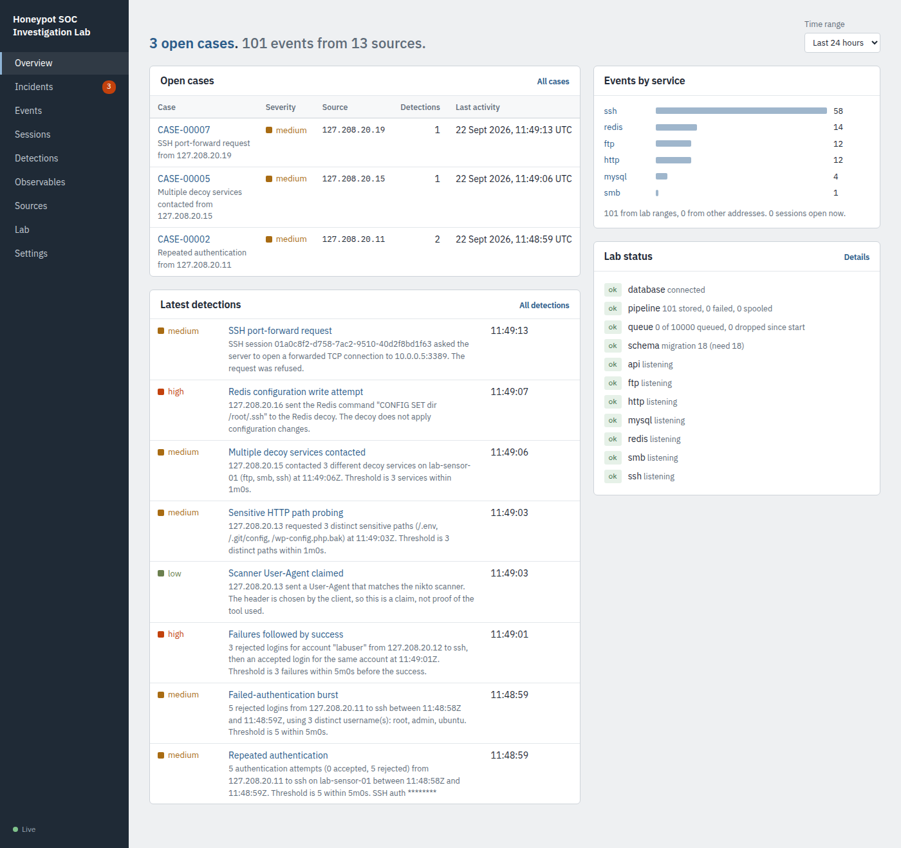
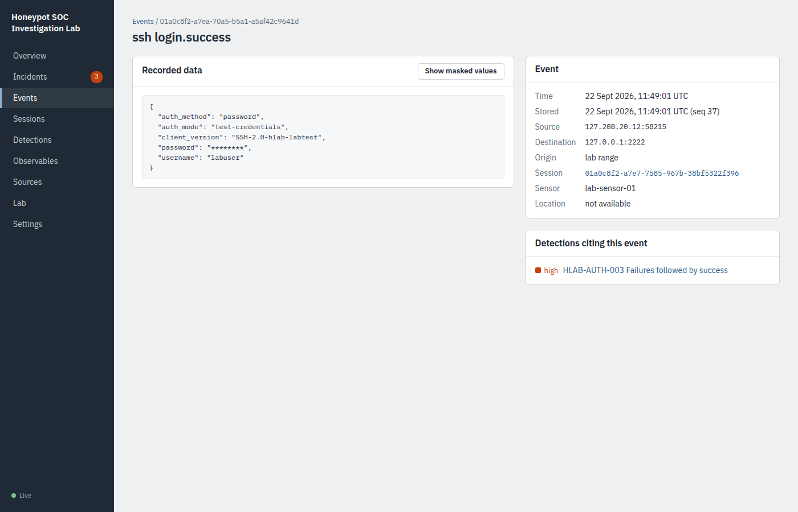
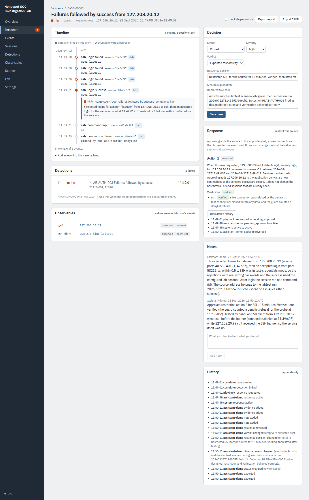

# Walkthrough: from a clean start to a closed case

This is the sequence that produced everything in `evidence/` and the
three reports in `docs/reports/`. It takes about 20 minutes. Commands
are for macOS; Linux differences are noted.

## 1. Start the lab with failed logins enabled

```bash
./scripts/setup-local.sh
./scripts/build-local.sh
# in config.yaml:  ssh.auth_mode: test-credentials
./bin/hive doctor
./bin/hive serve
```

Open http://127.0.0.1:8000. The Overview should say "No open cases".

## 2. Give each scenario its own address (macOS only)

```bash
sudo ./scripts/mac-loopback-aliases.sh add
```

Linux needs nothing: every 127.x address already works.

## 3. Capture the traffic and run the scenarios

Terminal 2 (macOS uses `lo0`, Linux `lo`):

```bash
sudo tcpdump -i lo0 -nn -s 0 -w evidence/pcaps/$(date -u +%Y%m%dT%H%M%SZ).pcap \
  'tcp and (port 2222 or port 8080 or port 2121 or portrange 30000-30009 or port 4450 or port 3307 or port 6380)'
```

Terminal 3:

```bash
./bin/labtest -out evidence/scenario-runs
```

Stop tcpdump with Ctrl-C when labtest finishes. All 11 scenarios should
pass; the report is in `evidence/scenario-runs/<run id>.json`.

## 4. Triage

The Overview now lists open cases. In the recorded run there were seven,
one per attack scenario; the three benign scenarios produced none, which
is part of the test.



## 5. Investigate a case

Open the case with "Failures followed by success". On the case page:

1. Read the timeline. The filled mark is the event that fired the rule,
   and the explanation sits under it. Outlined marks are the events that
   counted toward it.
2. Open an event to see the recorded fields. Passwords are masked; "Show
   masked values" reveals them and is written to the server log.
3. Check the session page for what happened after the login.
4. Add a note with what you checked.



## 6. Respond and verify

High-severity cases get a pending restriction. Choose SSH, 15 minutes,
Approve. The verification should say **verified**. If it says **not
confirmed**, read the reason: a stopped decoy, for example, cannot be
tested and is never reported as blocked.

Test it by hand from the restricted address (use the case's source
address):

```bash
nc -s 127.0.0.12 127.0.0.1 2222   # closed at once, no banner
nc -s 127.0.0.99 127.0.0.1 2222   # banner: the service is up
```

A `connection.denied` event appears in Events. Add it to the case
("Add an event to this case by hand"), then lift the restriction with a
reason.

## 7. Close and export

Set the verdict, a response decision and a closure explanation, then Save
case. Export the report and the JSON into `evidence/cases/`. Leave
"include passwords" off; the export is recorded in the case history either
way.



## 8. Write it up

Copy `docs/reports/TEMPLATE.md`, fill it from the export, and link the
capture packets. Annotate the capture in a file next to it: which source
address is which scenario, and the packets that show the key moments.
The files from the recorded run show the expected level of detail:

- [20260922T114853Z.md](../evidence/pcaps/20260922T114853Z.md)
- [20260922T115026Z-containment.md](../evidence/pcaps/20260922T115026Z-containment.md)

## What the recorded run produced

Run `20260922T114855Z-666cb1`, 22 September 2026, in the development environment (Ubuntu
24.04 container, PostgreSQL 16), not on Hiten's machine:

- 11 of 11 scenarios passed (test-credentials mode)
- 608 packets captured during the scenarios, 23 during the containment test
- 7 cases; 4 worked and closed as expected test activity
- 3 case exports in JSON and Markdown, 1 STIX export
